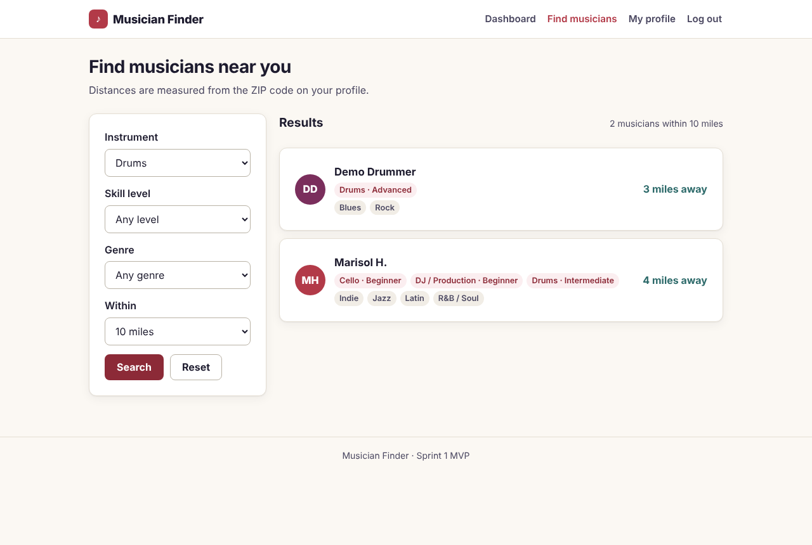
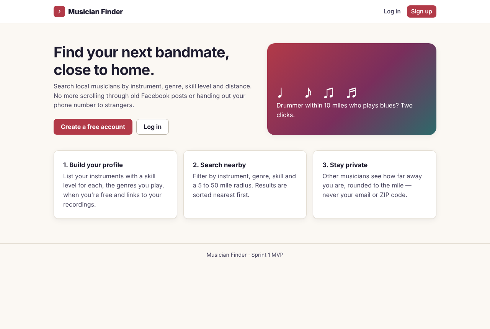
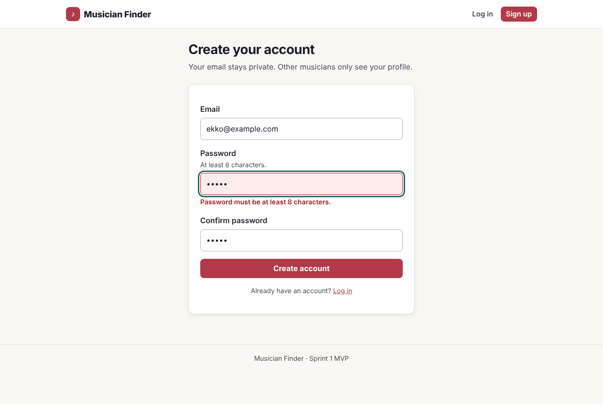
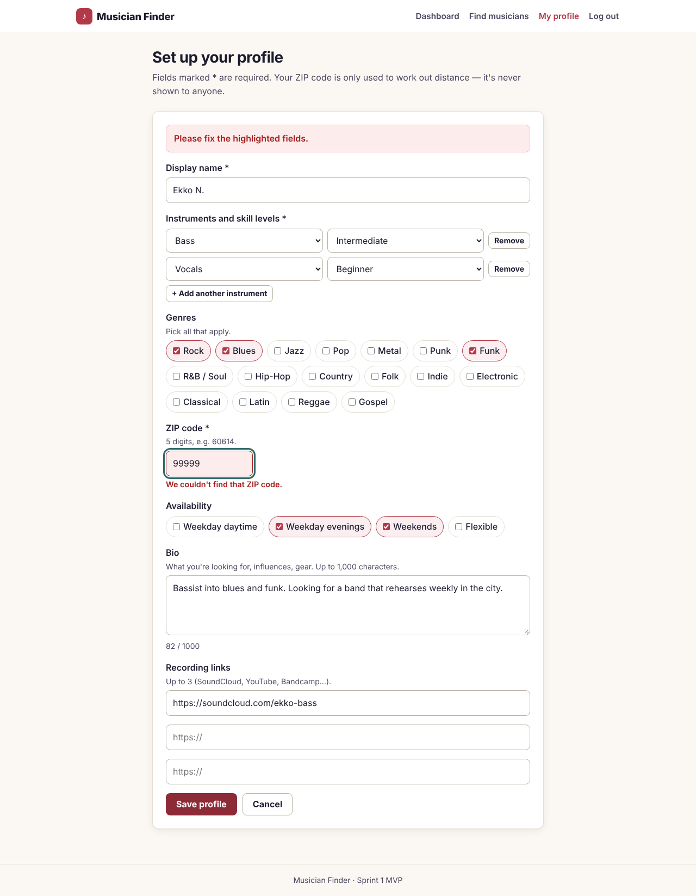
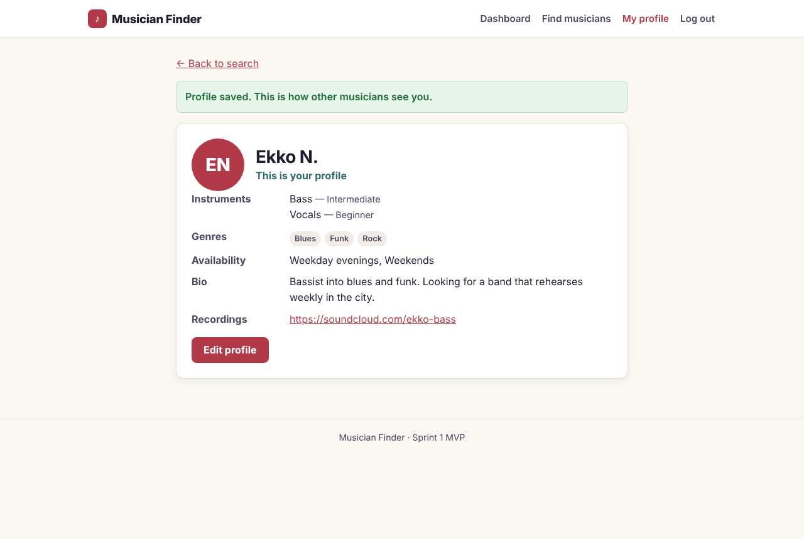
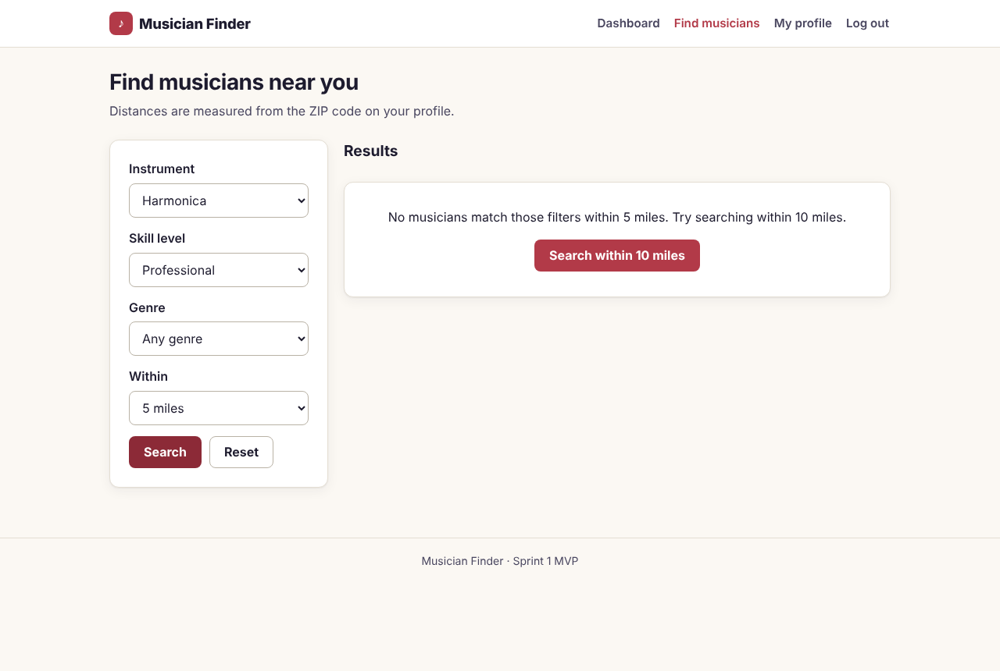
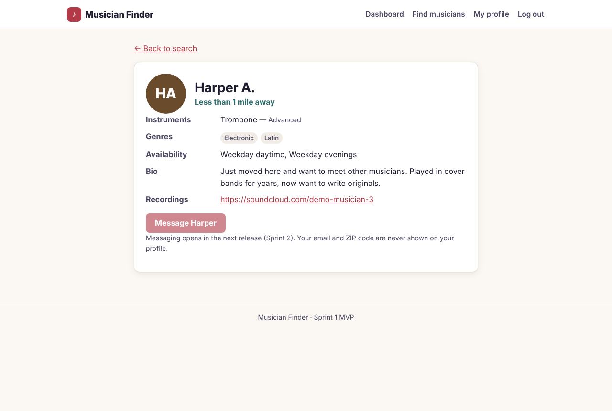
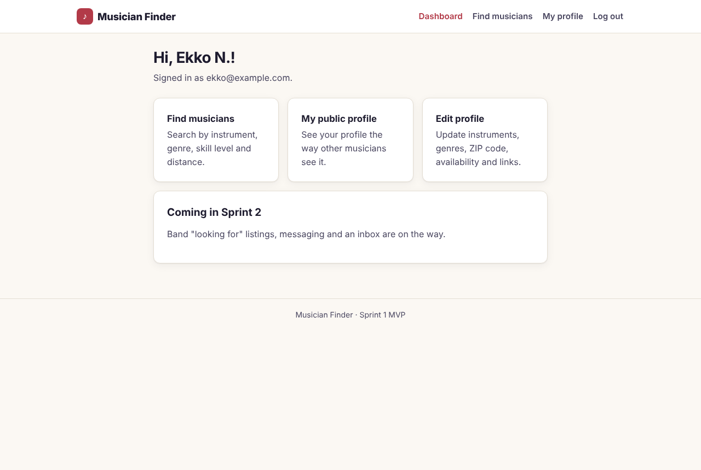
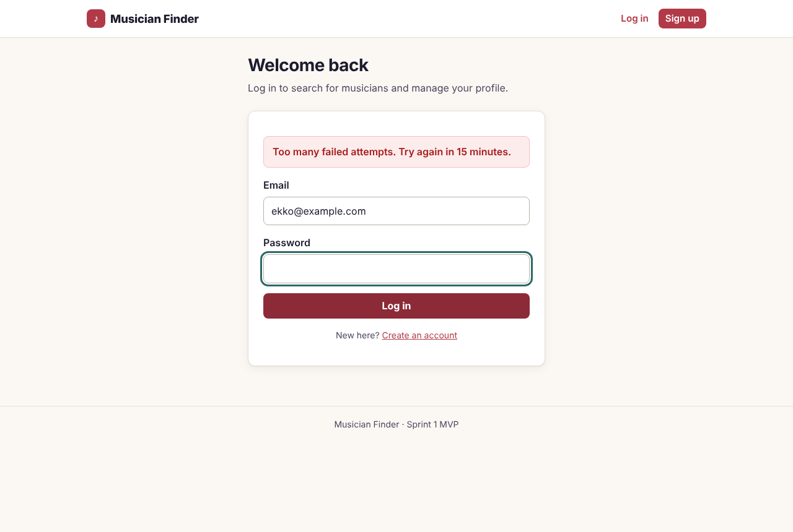
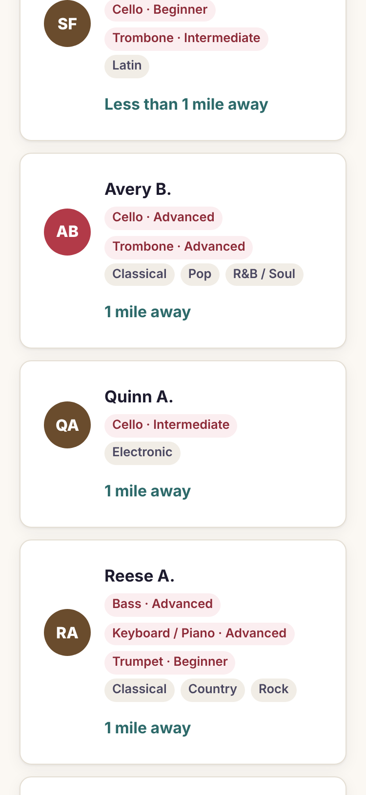

# Musician Finder

Musician Finder is a web app that helps local musicians find each other by **instrument, genre, skill level and distance**. Musicians build a profile, search for people nearby, and view each other's profiles without ever seeing an email address or ZIP code.

This repository contains the **Sprint 1 MVP** of my final project: accounts, profiles, musician search and public profiles.

**Live app:** https://musician-finder.onrender.com
**Jira board:** [Musician Finder – Ekko Nguyen (MFEN)](https://ic-team-s6hm98ws.atlassian.net/jira/software/projects/MFEN/boards/3)

> **Try it without signing up:** log in with `demo@musicianfinder.test` / `DemoPass123`.
> The free Render instance sleeps after 15 minutes without traffic, so the first page load can take up to a minute.



---

## Contents

- [Features (Sprint 1)](#features-sprint-1)
- [Screenshots](#screenshots)
- [Tech stack](#tech-stack)
- [Getting started](#getting-started)
- [Usage](#usage)
- [Architecture](#architecture)
- [Testing](#testing)
- [Deployment](#deployment)
- [Git workflow](#git-workflow)
- [Troubleshooting](#troubleshooting)
- [Known limitations](#known-limitations)
- [Planned enhancements](#planned-enhancements)

---

## Features (Sprint 1)

| Jira | User story | What works |
| --- | --- | --- |
| MFEN-1 | **US-1 Register an account** | Sign up with email + password (min. 8 characters). Duplicate emails are rejected (case-insensitive). Passwords are stored only as salted scrypt hashes. New users land on profile setup. |
| MFEN-2 | **US-2 Log in and log out** | Sessions last 7 days in an `HttpOnly`, `SameSite=Lax` (and `Secure` in production) cookie. Wrong credentials show one generic error. **5 failed attempts in 15 minutes lock login for 15 minutes.** Logout deletes the session on the server, and signed-in pages are sent with `Cache-Control: no-store` and guarded on the server, so the back button can't reopen them. |
| MFEN-3 | **US-3 Build a musician profile** | Display name, one or more instruments each with a skill level (beginner → professional), genres, ZIP code, availability, bio (≤ 1,000 chars) and up to 3 recording links. Display name, an instrument and a valid ZIP are required; an unknown ZIP is rejected and nothing is saved. Edits show on the public profile immediately. |
| MFEN-4 | **US-4 Search for musicians** | Filter by instrument, genre, skill level and distance (5, 10, 25 or 50 miles) from your ZIP. Every result matches all filters, results are sorted nearest first, 20 per page, and an empty search suggests a wider distance. |
| MFEN-5 | **US-5 View a musician's profile** | Name, instruments with skill levels, genres, availability, bio, recording links and distance rounded to the nearest mile. **Email and ZIP code never appear** (enforced by tests). The Message button is shown but disabled until messaging ships in Sprint 2. |
| MFEN-11 | **Setup task** | Repository, database schema, seed script, health check and Render deployment. |

## Screenshots

| | |
| --- | --- |
| **Home page**  | **Sign-up validation**  |
| **Profile form rejects an unknown ZIP**  | **Your saved profile**  |
| **Search: drummers within 10 miles**  | **Empty search suggests a wider distance**  |
| **Another musician's profile (no email/ZIP)**  | **Dashboard**  |
| **Login locked after 5 failures**  | **Phone layout (375 px)**  |

## Tech stack

| Layer | Technology |
| --- | --- |
| Frontend | HTML, CSS and vanilla JavaScript (`fetch`) — no build step |
| Server | Node.js 22 (`node:http`) with a small Express-style router (`src/lib/router.js`) |
| Database | SQLite through Node's built-in `node:sqlite` module |
| Passwords | `crypto.scrypt` (memory-hard, salted, constant-time compare) |
| ZIP → coordinates | Local cache of Chicago-area ZIPs + [Zippopotam.us](https://api.zippopotam.us) for everything else |
| Tests | Node's built-in test runner (`node:test`) with built-in coverage |
| Hosting | Render (free web service), auto-deploys from `main` |

**The app has zero npm dependencies.** Everything it uses ships with Node.js 22, so `npm install` isn't needed, there's nothing to audit or keep updated, and the Render build is fast. See [Architectural decisions](#architectural-decisions) for how this differs from the original plan.

## Getting started

### Prerequisites

- **Node.js 22.13 or newer** (`node --version`). The built-in `node:sqlite` module needs it. An `.node-version` file pins 22.16.0 for tools like `nvm`/`fnm`.
- Git.

### Run it locally

```bash
git clone https://github.com/sekkond2004/musician-finder.git
cd musician-finder
npm start            # no npm install needed — there are no dependencies
```

Open http://localhost:3000. On first start the server creates `data/musician-finder.db`, adds the instrument/genre lists, and seeds 60 demo musicians around Chicago plus the demo account.

Other commands:

```bash
npm run dev                      # restart automatically when files change
npm test                         # run all tests
npm run test:coverage            # tests + coverage report
npm run seed -- --reset          # wipe users/profiles and re-seed
npm run seed -- --count 1000     # seed 1,000 demo musicians (performance testing)
```

### Configuration

All settings are environment variables with safe defaults (see `.env.example`):

| Variable | Default | Purpose |
| --- | --- | --- |
| `PORT` | `3000` | HTTP port (Render sets this automatically) |
| `NODE_ENV` | `development` | `production` turns on `Secure` cookies and HSTS |
| `DATABASE_PATH` | `./data/musician-finder.db` | SQLite file; `:memory:` for a throwaway DB |
| `SEED_COUNT` | `60` | Demo musicians added when the database is empty (`0` to disable) |
| `ZIP_LOOKUP_ENABLED` | `true` | `false` stops calls to Zippopotam.us (only cached ZIPs work) |

## Usage

1. **Sign up** at `/register` (or log in with the demo account).
2. **Set up your profile**: display name, at least one instrument with a skill level, and your ZIP code. Add genres, availability, a bio and recording links if you like. Try a Chicago ZIP such as `60614` (Lincoln Park), `60622` (Wicker Park) or `60201` (Evanston) to be near the demo musicians.
3. **Find musicians** at `/search`: pick an instrument, skill level, genre and radius. Results are nearest first; filters are kept in the URL, so you can bookmark or share a search.
4. **Open a profile** to see someone's instruments, genres, availability, bio, recordings and how far away they are.
5. **Log out** from the header.

### REST API

All endpoints return JSON. Endpoints marked 🔒 need the session cookie.

| Method | Path | Description |
| --- | --- | --- |
| `GET` | `/health` | Health check (`{ status, database, uptimeSeconds }`) |
| `GET` | `/api/options` | Instruments, genres, skill levels, availability options, distances |
| `POST` | `/api/auth/register` | `{ email, password }` → creates the account and session |
| `POST` | `/api/auth/login` | `{ email, password }` → starts a session |
| `POST` | `/api/auth/logout` | Ends the session |
| `GET` | `/api/auth/me` 🔒 | Current user and whether they have a profile |
| `GET` | `/api/profile` 🔒 | Your own profile (includes your ZIP) |
| `PUT` | `/api/profile` 🔒 | Create/update your profile |
| `GET` | `/api/musicians?instrument=&genre=&skill=&distance=&page=` 🔒 | Search |
| `GET` | `/api/musicians/:id` 🔒 | Another musician's public profile |

Errors use one shape: `{ "error": { "code": "VALIDATION_ERROR", "message": "...", "fields": { "zip": "..." } } }`. Unexpected errors return a generic message plus a `requestId` that matches the server log line.

## Architecture

```
Browser (public/*.html + public/js/*.js)
   │  fetch() JSON
   ▼
node:http server ── src/server.js
   │
   ├─ Middleware chain      src/middleware/      request id, security headers, logging,
   │                                             JSON body parsing, session lookup, auth guards, errors
   ├─ Controllers           src/controllers/     HTTP ⇄ service calls (no rules, no SQL)
   ├─ Services              src/services/        business rules: validation, sessions, lockout,
   │                                             distance filtering, privacy
   ├─ Repositories          src/repositories/    every SQL query (parameterized)
   ▼
SQLite (node:sqlite) ── src/db/schema.sql
```

```
src/
  app.js              Factory: builds repositories → services → controllers → router
  server.js           Entry point: config, DB, demo seed, HTTP server, graceful shutdown
  config.js           Environment-based settings
  controllers/        auth, profile, search, meta (health/options), pages
  services/           AuthService, ProfileService, SearchService, GeocodingService
  repositories/       User, Session, LoginAttempt, Profile, Lookup repositories
  middleware/         Cross-cutting middleware
  lib/                router, HTTP helpers, errors, validation, geo math, password hashing
  db/                 schema.sql, database.js, seed.js, referenceData.js
public/               Static pages, CSS and browser JavaScript (the "views")
tests/
  unit/               Services and helpers tested with in-memory fakes
  integration/        The whole app over real HTTP with an in-memory database
  helpers/fakes.js    Fake repositories, fake clock, fake hasher
docs/screenshots/     README images
```

### Design patterns

| Pattern | Where | Why |
| --- | --- | --- |
| **MVC** | `public/` (views), `src/controllers/` (controllers), `src/services/` + `src/repositories/` (model) | A change to a page never touches a SQL query, and vice versa. |
| **Repository** | `src/repositories/*` | All SQL lives in one layer. Services get repositories through their constructor, so unit tests pass in-memory fakes (`tests/helpers/fakes.js`) with the same methods. |
| **Factory + dependency injection** | `createApp()` in `src/app.js` | The whole object graph is built in one place. Tests call it with `:memory:` SQLite, a fast hasher and a fake `fetch`; production calls it with the real ones. |
| **Chain of Responsibility** | `src/lib/router.js` + `src/middleware/` | Each request passes through an ordered list of `(req, res, next)` handlers, like Express. Async errors go straight to one error handler. |

### Database

| Table | Main columns | Notes |
| --- | --- | --- |
| `users` | `id`, `email` (unique, case-insensitive), `password_hash`, `created_at` | One row per account |
| `sessions` | `token_hash`, `user_id`, `expires_at` | Only a SHA-256 hash of the cookie token is stored |
| `login_attempts` | `email`, `attempted_at` | Drives the 5-in-15-minutes lockout |
| `profiles` | `user_id`, `display_name`, `bio`, `zip`, `latitude`, `longitude`, `availability`, `links` | One per user; coordinates stored at save time |
| `instruments`, `genres` | `id`, `name` | Seeded lists |
| `profile_instruments` | `profile_id`, `instrument_id`, `skill_level` | Many-to-many with a skill level per instrument |
| `profile_genres` | `profile_id`, `genre_id` | Many-to-many |
| `zip_codes` | `zip`, `latitude`, `longitude`, `place` | Cache of ZIP coordinates |

### How search works

1. Coordinates are looked up **once, when a profile is saved** (local cache first, then Zippopotam.us) and stored with the profile, so search never calls an outside API.
2. A search computes a latitude/longitude **bounding box** around the searcher and lets SQLite narrow the rows (indexed), applying instrument/genre/skill filters with `EXISTS` sub-queries.
3. `SearchService` computes the exact **Haversine** distance for each candidate, drops anyone outside the radius, sorts nearest first and returns page *n* of 20.
4. Distances are **rounded to the nearest mile** before they leave the server.

With 1,000 seeded profiles, a 50-mile search takes about **4 ms at the 95th percentile** on a laptop (`npm run seed -- --count 1000`), well inside the 1-second target.

### Security and privacy

- Passwords: salted `scrypt` (N=16384), constant-time comparison; stored format `scrypt$N$r$p$salt$hash` so cost can be raised later.
- Sessions: 256-bit random tokens; only their SHA-256 hash is stored; cookie is `HttpOnly`, `SameSite=Lax`, `Secure` in production; 7-day expiry; expired sessions are purged hourly.
- Login lockout: 5 failures in 15 minutes → 15-minute block (`429` with `Retry-After`).
- CSRF: `SameSite=Lax` cookies plus mutating API calls must be `application/json`.
- Every SQL statement is parameterized; every input is validated on the server.
- Security headers: Content-Security-Policy, `X-Frame-Options: DENY`, `nosniff`, HSTS in production.
- Privacy: ZIP codes only (never addresses); public responses never include email, ZIP or coordinates.
- Errors: users get a plain message; the server logs the stack with a request id.

### Architectural decisions

The planning document called for Express, PostgreSQL, bcrypt and Jest. For Sprint 1 I built the same layered design on **Node's built-in modules** instead:

- **SQLite (`node:sqlite`) instead of PostgreSQL.** Render's free PostgreSQL databases expire after 30 days, which would break the app before grading ends, and SQLite needs no separate service. The schema is plain SQL that maps 1:1 to PostgreSQL, and all SQL is isolated in the repositories, so moving to PostgreSQL in Sprint 3 only touches `src/repositories/` and `src/db/`.
- **A small router instead of Express.** `src/lib/router.js` implements the parts of Express this app uses (`use`, `get/post/put`, route params, async error forwarding) in about 100 lines.
- **scrypt instead of bcrypt.** Both are slow, salted password hashes; scrypt is built into Node, so there's no native module to compile on Render.
- **`node:test` instead of Jest.** Same `describe`/`it` style and built-in coverage, with no install.

## Testing

```bash
npm test               # 84 tests, ~1 second
npm run test:coverage  # with a per-file coverage table
```

**Approach.**

- **Unit tests** (`tests/unit/`) cover the business rules in each service using in-memory fake repositories, a fake clock (for session expiry and the lockout window) and a fake `fetch` (for the ZIP API). They check both success paths and failures: duplicate emails, short passwords, generic login errors, the 5-failure lockout and its expiry, 7-day sessions, profile validation (required fields, bad ZIPs, link limits, unknown instruments), search filters, distance limits, sorting, paging, empty-result suggestions and invalid query values.
- **Integration tests** (`tests/integration/api.test.js`) start the real app on a random port with an in-memory SQLite database and walk through the whole Sprint 1 flow over HTTP: register → profile → search → view profile → logout → login → lockout. They also check cookie flags, that the stored password is a hash, that public responses contain no email/ZIP, that signed-out users are redirected, that path traversal is blocked, and that unexpected errors return a generic message with a request id.

**Coverage (Sprint 1):** about **95% of lines and branches** across `src/`. All services are at 99–100% line coverage. The lowest file is `src/db/seed.js`, whose demo-data generator is exercised when the server starts rather than by tests.

Render runs `npm test` as the build command, so **a deploy fails if any test fails**.

## Deployment

The app runs on **Render** as a free Node web service, configured by [`render.yaml`](render.yaml):

- **Build command:** `npm test` (no dependencies to install, so the build step is the test suite)
- **Start command:** `npm start`
- **Health check:** `/health`
- **Environment:** `NODE_ENV=production`, `NODE_VERSION=22.16.0`
- **Auto-deploy:** every push or merged pull request to `main` triggers a new deploy.

To deploy your own copy: fork the repo, then in Render choose **New → Blueprint**, pick the repo, and accept the settings from `render.yaml` (or create a **Web Service** by hand with the commands above).

## Git workflow

- `main` always holds working, deployable code.
- Each user story or task is built on its own branch named after its Jira key, e.g. `feature/MFEN-3-musician-profile`.
- Commits follow [Conventional Commits](https://www.conventionalcommits.org/) (`feat:`, `fix:`, `test:`, `docs:`, `chore:`) and explain what changed and why.
- Each branch is merged into `main` through a pull request whose description lists the changes, the Jira story and how it was tested.

## Troubleshooting

| Problem | Fix |
| --- | --- |
| `Error: No such built-in module: node:sqlite` | Your Node is too old. Install Node **22.13+** (`nvm install 22`) and check `node --version`. |
| `ExperimentalWarning: SQLite is an experimental feature` | Harmless. The npm scripts hide it with `--disable-warning=ExperimentalWarning`; you only see it when running `node` directly. |
| `EADDRINUSE: address already in use :::3000` | Another process is on port 3000. Stop it, or run `PORT=3001 npm start` (PowerShell: `$env:PORT=3001; npm start`). |
| "We couldn't find that ZIP code" for a real ZIP | The ZIP isn't in the local cache and the Zippopotam.us lookup failed or is disabled. Check your internet connection and that `ZIP_LOOKUP_ENABLED` isn't `false`, or use a Chicago-area ZIP such as `60614`. |
| "We couldn't check that ZIP code right now" | Zippopotam.us didn't answer in 5 seconds. Try again in a minute. |
| Search says to set up your profile first | Search measures distance from your ZIP, so save a profile before searching. |
| "Too many failed attempts" | Login is locked for 15 minutes after 5 wrong passwords. Wait, or for local development run `npm run seed -- --reset`. |
| I want a fresh local database | Stop the server and delete the `data/` folder (or run `npm run seed -- --reset`). |
| The live site takes a long time to load | The free Render instance sleeps after 15 minutes idle; the first request wakes it (up to ~1 minute). |
| Accounts I created on the live site disappeared | See the first known limitation below. |

## Known limitations

- **Live data resets on each deploy or restart.** Render's free tier has no persistent disk, so the SQLite file is rebuilt (with fresh demo data) whenever the service restarts or redeploys. Moving to a hosted PostgreSQL database is planned for Sprint 3.
- **Messaging isn't built yet.** The Message button on profiles is visible but disabled; messaging and the inbox are Sprint 2 (US-8, US-9).
- **Skill-level filter matches exactly.** Searching for "advanced" doesn't include "professional" players.
- **Login lockout is per email address**, not per IP, and there is no password reset or email verification yet.
- **US ZIP codes only**, and demo musicians are all around Chicago, so other areas will show few results until real users sign up there.
- No ESLint configuration or CI pipeline yet (planned for Sprint 3).

## Planned enhancements

- **Sprint 2:** "looking for" band listings and listing search (US-6, US-7); messaging with an inbox and unread counts (US-8, US-9).
- **Sprint 3:** block and report (US-10); GitHub Actions CI for lint + tests on every pull request; PostgreSQL for persistent data; uptime monitoring and structured error logging; 70%+ coverage kept as a merge requirement.
- **Later:** React frontend on the same API, real-time chat over WebSockets, audio clip uploads, and weekly bandmate match suggestions.

---

Built by Ekko Nguyen for the final project, Sprint 1 (Unit 11).
